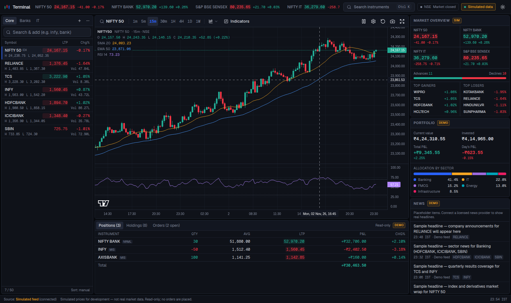
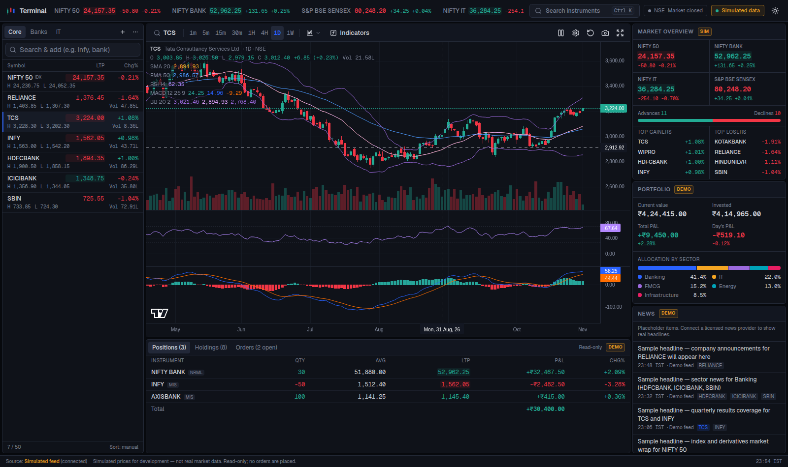
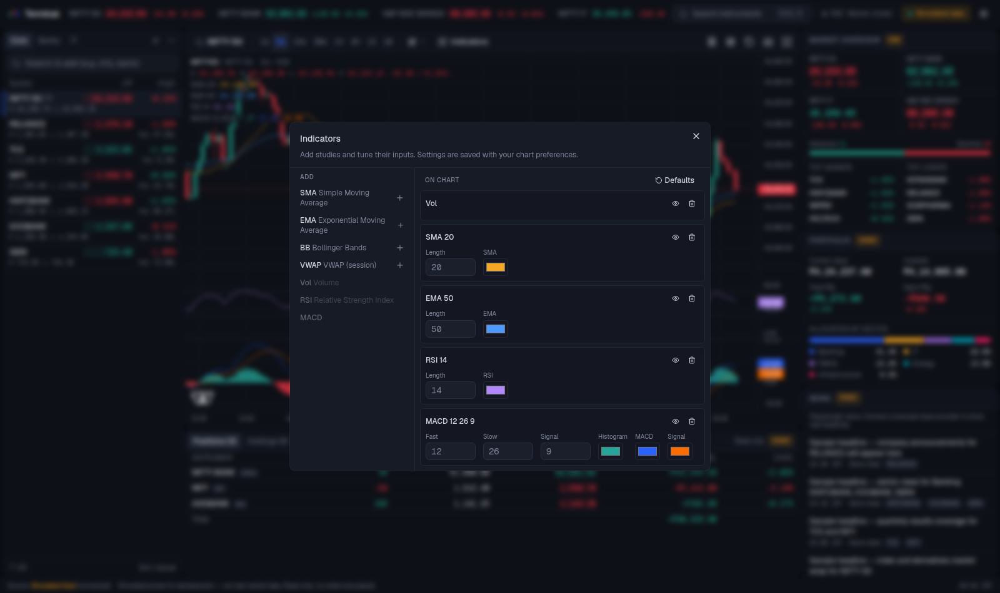
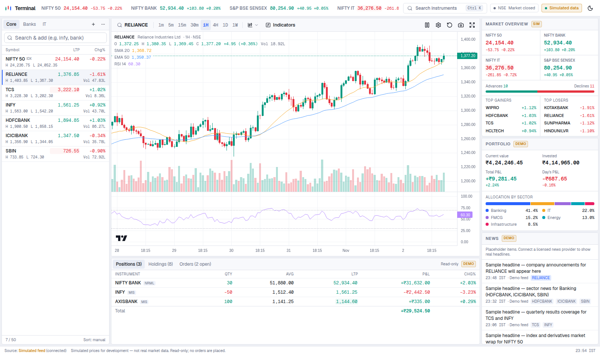
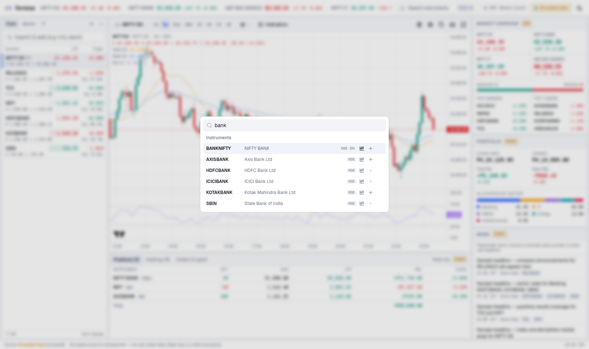
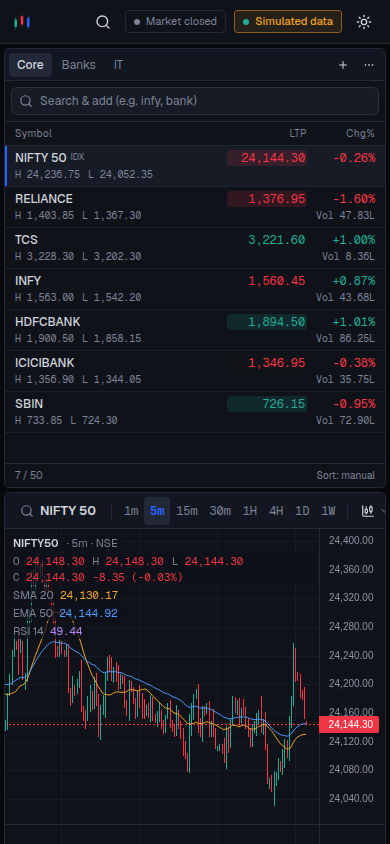

# Trading Dashboard

A customizable, real-time trading terminal for Indian markets (NSE/BSE), built with Next.js,
TypeScript and TradingView Lightweight Charts.

> **Status: Phase 1–2 (UI + interactive charts) — running on SIMULATED data.**
> Every price, candle and volume shown is generated by a random-walk simulator for development.
> It is labelled as such throughout the UI and is **not real market data**. Portfolio, positions,
> orders and news are fictional demo fixtures. The app is read-only: it never places orders.

## Screenshots

> All prices in these screenshots come from the built-in simulator; portfolio, orders and news are
> demo fixtures.

**Terminal — dark theme (default)**



**Daily chart with Bollinger Bands, volume, RSI and MACD**



**Indicator settings**



**Light theme**



**Instrument search (Ctrl/⌘ + K)**



**Mobile layout**



## Quick start

Requirements: Node.js ≥ 22, pnpm ≥ 10.

```bash
pnpm install
pnpm dev            # http://localhost:3000
```

No environment variables or credentials are needed for Phase 1–2. Optional: copy
`.env.example` to `apps/web/.env.local` to change the data source once more sources exist.

| Command          | What it does                                                  |
| ---------------- | ------------------------------------------------------------- |
| `pnpm dev`       | Start the web app (Turbopack dev server)                      |
| `pnpm build`     | Production build of the web app                               |
| `pnpm test`      | Unit tests (Vitest) for indicators, aggregation, portfolio, … |
| `pnpm typecheck` | TypeScript across all workspaces                              |
| `pnpm lint`      | ESLint                                                        |
| `pnpm format`    | Prettier                                                      |
| `pnpm check`     | typecheck + lint + test + format check (use in CI)            |

## What works today

- **Terminal layout** — top bar (index ticker, instrument search, NSE session status, data-source
  status, theme toggle), watchlist sidebar, chart, positions/holdings/orders, market overview,
  portfolio summary, news; responsive down to phone width.
- **Charts** — candlestick, OHLC bars, line and area; timeframes 1m, 5m, 15m, 30m, 1H, 4H, 1D, 1W;
  crosshair legend with OHLC/change/volume; zoom & pan with automatic back-loading of older
  history; live bar updates from ticks (pausable); log scale; magnet crosshair; full screen;
  PNG snapshot. Axis and crosshair times are always shown in IST.
- **Indicators** — SMA, EMA, Bollinger Bands, VWAP (session-anchored), Volume, RSI and MACD in
  their own panes; add/remove, show/hide, edit inputs and colours.
- **Watchlists** — multiple lists (create/rename/delete), add via search, remove, sort by
  symbol/LTP/%change/volume, live LTP with up/down tick flash, day high/low and volume.
- **Persistence** — chart preferences, indicators, watchlists and theme are saved in the browser
  (moves to per-user server storage in Phase 4).
- **Keyboard** — `Ctrl/⌘ + K` or `/` opens instrument search.

## Repository layout

```
apps/
  web/              Next.js (App Router) terminal UI
  api/              Express + Socket.IO backend          (Phase 4–5, placeholder)
packages/
  shared/           Domain types + pure logic: timeframes, market hours, indicators,
                    portfolio math, formatting, instrument reference data
  market-data/      Provider interface, candle aggregator, quote book, subscription
                    manager, simulated provider; FYERS/Kite adapters land here (Phase 6)
infrastructure/     Docker / deployment                    (Phase 8, placeholder)
docs/               Architecture, roadmap, provider setup
```

## Documentation

- [Architecture](docs/ARCHITECTURE.md) — how the pieces fit and why
- [Implementation plan & roadmap](docs/IMPLEMENTATION_PLAN.md) — phases 1–8
- [Market data providers](docs/MARKET_DATA_PROVIDERS.md) — configuring FYERS / Zerodha Kite

## Data and compliance notes

- Live prices will only come from official, licensed broker/data APIs (FYERS API, Zerodha Kite
  Connect). No scraping, no unofficial endpoints.
- Broker API keys, secrets and access tokens live only on the backend (environment variables).
  The browser never receives them; `NEXT_PUBLIC_*` variables must never hold secrets.
- Lightweight Charts™ is © TradingView, Inc. (Apache-2.0); the attribution logo on the chart is
  kept as required by its licence.
